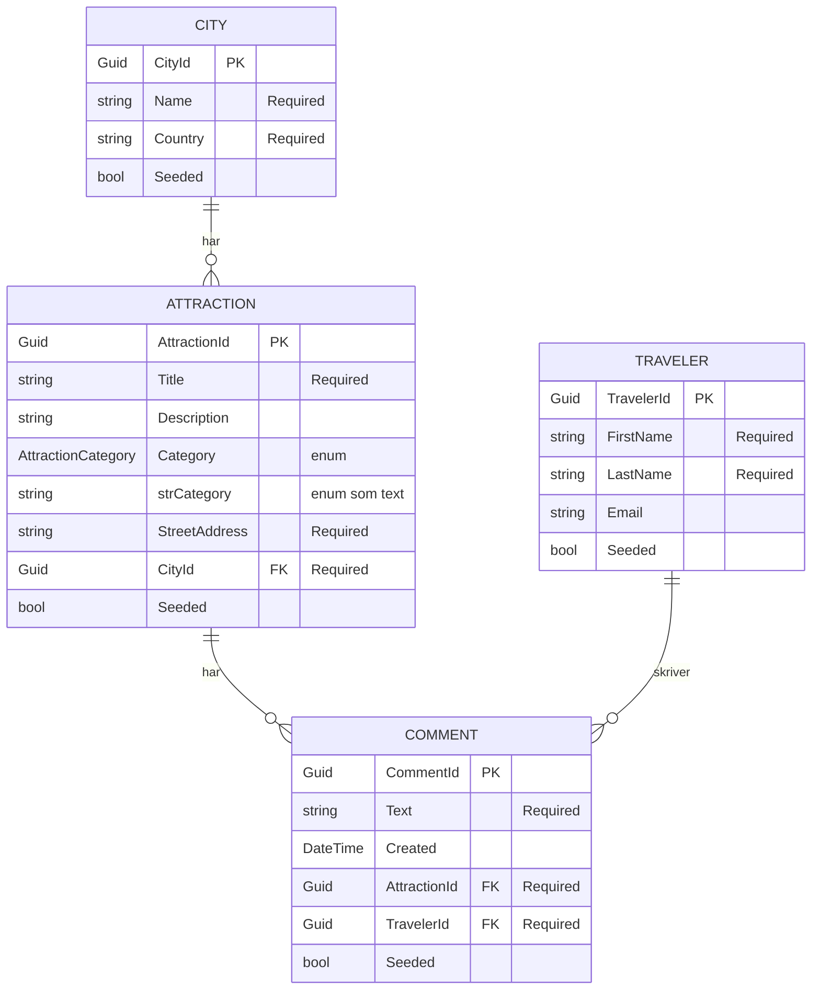

# TravelApp – ER-modell

ERD i crow's foot-notation. Diagrammet renderas direkt på GitHub. Källkoden finns även i [ERD.mmd](ERD.mmd)
och kan exporteras till PNG/SVG via https://mermaid.live.

## Relationer

| Relation | Kardinalitet | Läses som |
|---|---|---|
| City – Attraction | 1 : 0..* | En ort har noll eller flera sevärdheter. En sevärdhet ligger i exakt en ort. |
| Attraction – Comment | 1 : 0..* | En sevärdhet har 0–20 kommentarer. En kommentar hör till exakt en sevärdhet. |
| Traveler – Comment | 1 : 0..* | En användare skriver noll eller flera kommentarer. En kommentar har exakt en författare. |

## Förklaring av C#-klasserna

**Utgångspunkt.** Jag har följt kursens mönster med tre nivåer per entitet:
ett interface i `Models` (t.ex. `IAttraction`), en domänklass i `Models` (t.ex. `Attraction`) och en
databasklass i `DbModels` (t.ex. `AttractionDbM`) som ärver domänklassen och lägger till det som bara rör
databasen: `[Key]`, `[Required]`, `[Index]`, främmande nycklar och EF Core-navigeringsproperties.

**City (ort).** Uppgiften kräver orter fördelade på minst 4 länder och filtrering på både land och ort.
Land lagras som en kolumn `Country` på orten. Ett eget land-tabell hade varit mer normaliserat, men
landet har inga egna data utöver namnet, så det ger bara en extra join utan nytta. Ett unikt index på
`(Name, Country)` förhindrar dubbletter av samma ort, och indexet används också vid filtrering.

**Attraction (sevärdhet).** Innehåller rubrik (`Title`), beskrivning, kategori och gatuadress, och en
obligatorisk främmande nyckel `CityId`. Adressen ligger direkt på sevärdheten eftersom varje sevärdhet
har sin egen adress, medan ort och land hämtas via relationen till `City`. Kategorin är en `enum`
(`Restaurant`, `Cafe`, `Architecture`, `Museum`, …) så att bara giltiga värden kan användas; den sparas
även som text (`strCategory`) för läsbarhet i databasen, på samma sätt som `Kind` i kursens `Pet`.
Index på `Title` och `Category` eftersom tjänsterna filtrerar på dem.

**Comment (kommentar).** Är kopplingen mellan användare och sevärdhet och har därför två obligatoriska
främmande nycklar, `AttractionId` och `TravelerId`, samt text och tidpunkt. Båda relationerna har
*cascade delete*: tas en sevärdhet eller en användare bort försvinner deras kommentarer automatiskt.

**Traveler (användare).** De användare som skriver kommentarer. Klassen heter `Traveler` i stället
för `User` eftersom templaten redan har en `User`-tabell (`dbo.Users`) som används för inloggning med
lösenord och roller. Att hålla dem isär gör att testdata kan seedas och tas bort utan att påverka
inloggningskontona.

**Gemensamt för alla tabeller.**
- Primärnycklar är `Guid`, som i kursen, så att id kan skapas i C# innan posten sparas (enkelt vid seeding).
- `Seeded` markerar testdata så att stored proceduren kan ta bort just den (krav 7).
- Navigeringsproperties (`City.Attractions`, `Attraction.Comments`, `Traveler.Comments`) gör att
  EF Core kan hämta relaterad data med `Include`, t.ex. en sevärdhet med alla dess kommentarer.
- Alla tabeller ligger i schemat `supusr`, som kursens övriga datatabeller.
